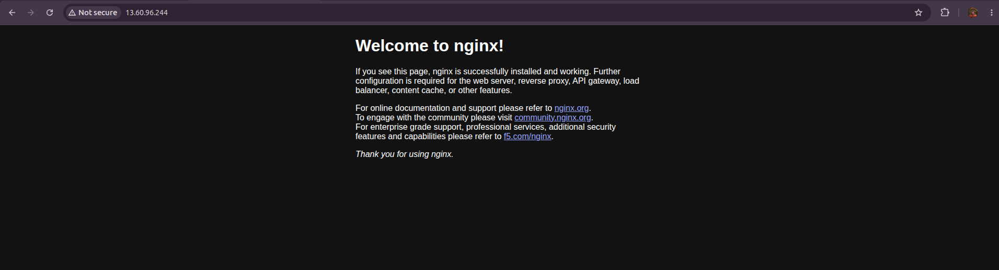
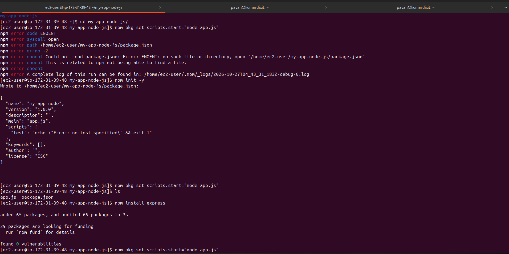
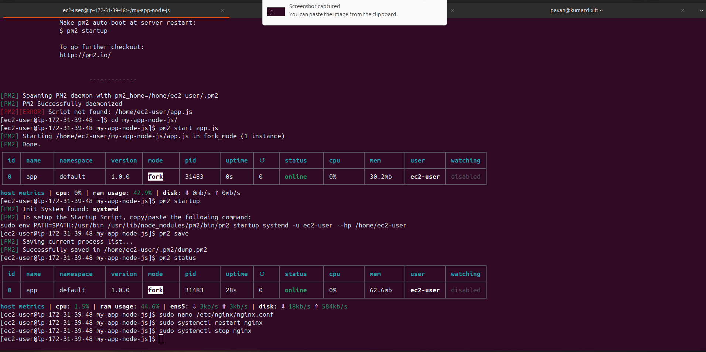
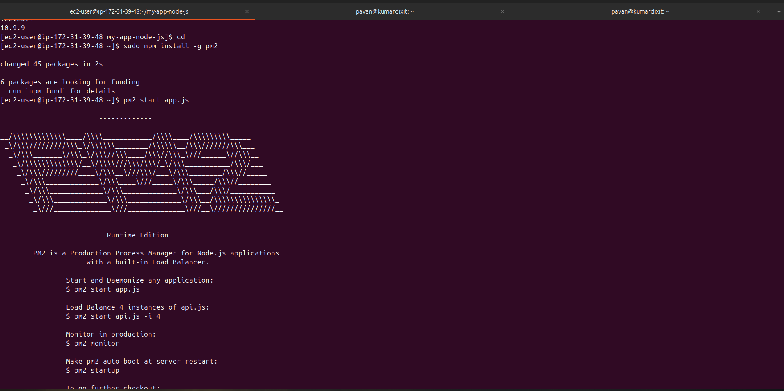
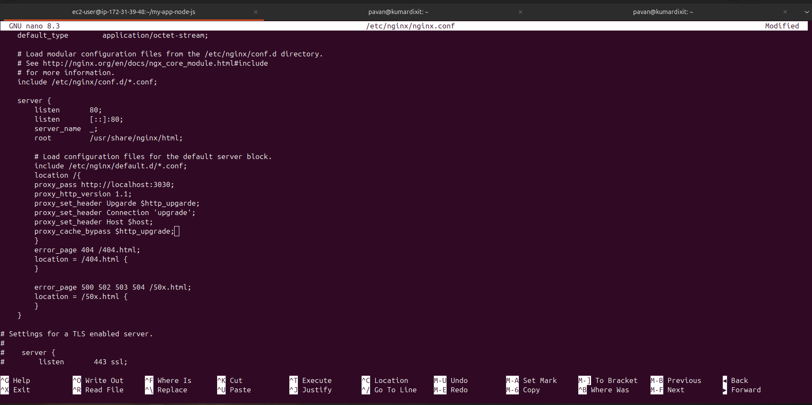
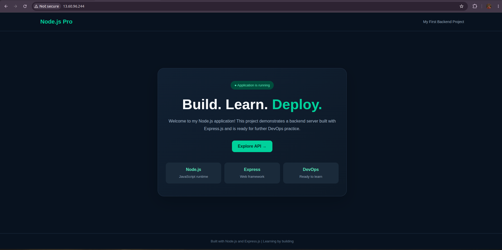

# Deploy a Node.js Application on AWS EC2 Using Nginx and PM2

A hands-on AWS project that demonstrates how to deploy a Node.js application on an **Ubuntu EC2 instance**, manage the application with **PM2**, and configure **Nginx as a reverse proxy** so visitors can access the app through the EC2 public IP address.

## Project Overview

In this project, you will:

- Connect to an EC2 instance using SSH.
- Update Ubuntu packages and install Nginx.
- Verify the default Nginx welcome page in a browser.
- Install Node.js and npm, then verify their versions.
- Transfer the Node.js project from your local machine to EC2 using SCP.
- Install project dependencies with npm.
- Run the app in the background using PM2.
- Configure PM2 to restore the app after a reboot.
- Configure Nginx to forward HTTP requests to the Node.js app.
- Restart Nginx and verify the deployed application.

## Tech Stack

| Technology | Purpose |
|---|---|
| AWS EC2 | Hosts the application on a virtual server |
| Ubuntu Server | Operating system |
| Nginx | Web server and reverse proxy |
| Node.js | Runs the JavaScript application on the server |
| npm | Installs Node.js project dependencies |
| PM2 | Keeps the Node.js application running and manages its process |
| SSH | Secure remote server access |
| SCP | Secure file transfer |

## Architecture

```text
User's Browser
     |
     | HTTP :80
     v
EC2 Security Group
     |
     v
Nginx (:80)
     |
     | Reverse proxy to 127.0.0.1:3000
     v
Node.js Application (app.js)
Managed by PM2
```

Nginx receives public HTTP requests on port 80 and forwards them to the Node.js application on port 3000. The Node.js port should remain private; users access the app through Nginx.

## Repository Structure

```text
.
├── app.js
├── Nginx-Image/
│   ├── nginx-check-ec2.png
│   ├── nginx_configuration-file.png
│   ├── nginx-insatll-node-1.png
│   ├── nginx-insatll-node-2.png
│   ├── nginx-install-ec2.png
│   ├── nginx-install-pm2.png
│   ├── nginx-npm-init.png
│   ├── nginx-pm2-command.png
│   ├── nginx-welcome-page.png
│   └── Output-node-page-ec2.png
├── package.json
└── package-lock.json
```

## Prerequisites

- An AWS account with access to EC2.
- An Ubuntu EC2 instance with a public IPv4 address.
- The private key (`.pem`) associated with the instance.
- Your local computer has SSH and SCP available.
- Your Node.js project includes `app.js` and `package.json`.
- The app listens on a known port. The example below uses port `3000`.

> **Important: Ubuntu vs Amazon Linux usernames.** For a standard Ubuntu EC2 instance, the default SSH username and home directory are usually `ubuntu` and `/home/ubuntu`. For Amazon Linux, they are commonly `ec2-user` and `/home/ec2-user`. This guide uses Ubuntu commands. Do not use `/home/ec2-user` on Ubuntu unless you have explicitly created that user.

## Step 1: Configure the EC2 Security Group

In the AWS Console, open **EC2 → Instances → your instance → Security → Security groups → Edit inbound rules**.

Add the following rules:

| Type | Port | Source | Purpose |
|---|---:|---|---|
| SSH | 22 | My IP | Connect to the server |
| HTTP | 80 | `0.0.0.0/0` | Access the website |

Restrict SSH to **My IP**. Do not open port `3000` publicly; Nginx will proxy requests to the application locally.

## Step 2: Connect to the Ubuntu EC2 Instance

On your **local terminal**, set permissions on the private key and connect:

```bash
chmod 400 "/path/to/your-key.pem"
ssh -i "/path/to/your-key.pem" ubuntu@YOUR_EC2_PUBLIC_IP
```

Replace `/path/to/your-key.pem` and `YOUR_EC2_PUBLIC_IP` with your actual key path and EC2 public IP. The commands below are run on the EC2 instance unless stated otherwise.

## Step 3: Update Ubuntu and Install Nginx

Update the package list and installed packages:

```bash
sudo apt update
sudo apt upgrade -y
```

Install Nginx:

```bash
sudo apt install nginx -y
```

Start Nginx now and enable it to start automatically after reboot:

```bash
sudo systemctl enable --now nginx
```

Check its status:

```bash
sudo systemctl status nginx --no-pager
```

Check the Nginx version and configuration syntax:

```bash
nginx -v
sudo nginx -t
```

### Verify the Nginx welcome page

Open a **new Chrome tab** and visit:

```text
http://YOUR_EC2_PUBLIC_IP
```

You should see the default **Welcome to nginx!** page if Nginx is running and port 80 is reachable.



If the page does not open, check the Security Group's HTTP rule, the instance's public IP, and `sudo systemctl status nginx`.

## Step 4: Install Node.js and npm

On Ubuntu, install the Node.js runtime and npm using the package manager:

```bash
sudo apt install nodejs npm -y
```

Verify the versions:

```bash
node -v
npm -v
```

Check the executable paths if needed:

```bash
which node
which npm
```

> **Version note:** Ubuntu's default repositories may not contain the newest Node.js LTS release. If your project requires a specific Node.js version, install a compatible supported LTS release and verify it with `node -v` before continuing.

## Step 5: Transfer the Node.js Project to EC2 with SCP

Keep the EC2 SSH session open. Open a **second terminal on your local machine** and run SCP from the directory containing your project.

For example, if the local project directory is named `Node-Nginx-App`:

```bash
scp -i "/path/to/your-key.pem" -r "./Node-Nginx-App" ubuntu@YOUR_EC2_PUBLIC_IP:/home/ubuntu/
```

This copies the project to `/home/ubuntu/Node-Nginx-App` on an Ubuntu EC2 instance. Replace the local directory, key path, and public IP with your actual values.

If you want to transfer only the project files from the current local directory, you can use:

```bash
scp -i "/path/to/your-key.pem" app.js package.json package-lock.json ubuntu@YOUR_EC2_PUBLIC_IP:/home/ubuntu/
```

Run this command from the local project directory. If the project has additional required files or folders, transfer those too.


> If your actual EC2 instance is **Amazon Linux** rather than Ubuntu, use `ec2-user@YOUR_EC2_PUBLIC_IP:/home/ec2-user/` as the destination and follow Amazon Linux-specific package installation commands. Do not mix Ubuntu and Amazon Linux commands.

## Step 6: Install Project Dependencies

Return to the **original EC2 SSH terminal** and change to the directory where you copied the project.

For the example above:

```bash
cd /home/ubuntu/Node-Nginx-App
ls -la
```

Make sure `app.js`, `package.json`, and (if supplied) `package-lock.json` are present.

Install the dependencies:

```bash
npm install
```

`npm install` reads `package.json` and installs the packages the application needs. If a valid `package-lock.json` is committed and you want a reproducible deployment, you can use `npm ci` instead. Use one of these commands, not both by default.



## Step 7: Check the Application Port

Before starting the application, confirm which port `app.js` listens on. This guide assumes the app listens on **port 3000** and binds to localhost or all interfaces as appropriate.

For a simple Express app, the listening code may look like this:

```javascript
const PORT = process.env.PORT || 3000;

app.listen(PORT, "127.0.0.1", () => {
  console.log(`App running on port ${PORT}`);
});
```

Use code that matches your actual app framework and existing `app.js`; do not paste this snippet blindly if the app is not an Express application. Since Nginx and the Node.js app run on the same EC2 instance, binding the app to `127.0.0.1` is suitable for a basic reverse-proxy setup.

## Step 8: Start the Application with PM2

Install PM2 globally:

```bash
sudo npm install -g pm2
```

Check the installed version:

```bash
pm2 -v
```

Start the application from the project directory:

```bash
pm2 start app.js --name node-app
```

Check process status and logs:

```bash
pm2 status
pm2 logs node-app
```

You can also check the app locally on the EC2 instance (assuming port 3000):

```bash
curl -I http://127.0.0.1:3000
```

A successful HTTP response indicates that the app is responding. If the command fails, inspect `pm2 logs node-app` and verify the port configured in `app.js`.



## Step 9: Configure PM2 to Restore the App After Reboot

Generate the startup command:

```bash
pm2 startup
```

PM2 will print a command tailored to the current system and user. **Copy and execute the exact command PM2 prints**; it commonly starts with `sudo env ... pm2 startup systemd ...`.

Then save the current process list:

```bash
pm2 save
```

Verify the application is registered and online:

```bash
pm2 status
```

`pm2 startup` configures the boot-time service, while `pm2 save` saves the current process list that PM2 should restore. Run both steps.



## Step 10: Configure Nginx as a Reverse Proxy

On Ubuntu, the usual site configuration file is:

```text
/etc/nginx/sites-available/default
```

This guide edits the default site file, not the main `/etc/nginx/nginx.conf`. Back up the existing file first:

```bash
sudo cp /etc/nginx/sites-available/default /etc/nginx/sites-available/default.bak
sudo nano /etc/nginx/sites-available/default
```

Inside the active `server { ... }` block, configure the site to forward requests to the Node.js app on port 3000. A basic server block can look like this:

```nginx
server {
    listen 80 default_server;
    listen [::]:80 default_server;

    server_name _;

    location / {
        proxy_pass http://127.0.0.1:3000;
        proxy_http_version 1.1;

        proxy_set_header Host $host;
        proxy_set_header X-Real-IP $remote_addr;
        proxy_set_header X-Forwarded-For $proxy_add_x_forwarded_for;
        proxy_set_header X-Forwarded-Proto $scheme;
    }
}
```

If the file already contains a `server` block, edit that block rather than accidentally leaving two conflicting default server blocks enabled. Ensure the configuration points to the port your app actually uses.

Save in nano with **Ctrl+O**, press **Enter**, then exit with **Ctrl+X**.



Test the configuration before applying it:

```bash
sudo nginx -t
```

Only if the test succeeds, restart Nginx:

```bash
sudo systemctl restart nginx
sudo systemctl status nginx --no-pager
```

You can use `sudo systemctl reload nginx` for many configuration changes, but this project uses restart to make the step explicit.

## Step 11: Verify the Final Deployment

1. Confirm the app is online:

   ```bash
   pm2 status
   ```

2. Confirm Nginx is running:

   ```bash
   sudo systemctl status nginx --no-pager
   ```

3. Test the app through Nginx from EC2:

   ```bash
   curl -I http://localhost
   ```

4. Open or refresh Chrome:

   ```text
   http://YOUR_EC2_PUBLIC_IP
   ```

You should now see your Node.js application's output instead of the default Nginx welcome page.



## Troubleshooting

| Problem | Possible cause | What to check |
|---|---|---|
| Nginx welcome page still appears | Default site configuration was not updated or another server block is active | Check `/etc/nginx/sites-available/default`, then run `sudo nginx -t` |
| `502 Bad Gateway` | Node.js app is stopped or Nginx points to the wrong port | Run `pm2 status`, inspect `pm2 logs node-app`, and verify `proxy_pass` |
| `curl localhost:3000` fails | App is not listening on port 3000 or failed to start | Check `app.js`, `pm2 logs node-app`, and the configured port |
| `npm install` fails | Missing files, incompatible Node version, or dependency error | Check `node -v`, `npm -v`, `package.json`, and npm output |
| SCP fails with `Permission denied (publickey)` | Wrong key or username | Use the correct `.pem` file and the right username (`ubuntu` for Ubuntu) |
| Browser cannot connect | Port 80 is blocked or the instance has no reachable public route | Check the Security Group, public IP, instance state, and subnet routing |
| Nginx configuration test fails | Typo or invalid server block | Read the error from `sudo nginx -t` before restarting |
| App stops after SSH closes | App was started in the foreground rather than managed by PM2 | Start it using `pm2 start app.js --name node-app` |
| App does not return after reboot | PM2 startup setup or saved process list is missing | Run `pm2 startup`, execute its generated command, then `pm2 save` |

Useful diagnostic commands:

```bash
pm2 status
pm2 logs node-app --lines 100
sudo nginx -t
sudo journalctl -u nginx --no-pager -n 50
sudo tail -n 50 /var/log/nginx/error.log
sudo ss -tlnp
```

## Security Best Practices

- Keep your `.pem` private key secret and never commit it to GitHub.
- Restrict inbound SSH on port 22 to your own IP address.
- Expose only the ports needed by the application. In this setup, public access is through Nginx on port 80; do not open Node.js port 3000 to the internet.
- Do not store AWS access keys, passwords, or other secrets in source code or Git.
- Keep Ubuntu packages and Node.js dependencies updated.
- Use HTTPS with a valid TLS certificate for production use.
- Run production applications with an appropriate least-privilege user and review logs regularly.

## Cost Awareness and Cleanup

EC2 instances, EBS volumes, public IPv4 addresses, snapshots, and data transfer may incur charges depending on your region, account, and configuration. When finished practicing, stop or terminate the instance if you no longer need it, review unused resources, and check the AWS Billing console. Do not assume that every configuration is free.

## What I Learned

- Installing and managing Nginx on Ubuntu.
- Installing Node.js and npm and deploying a Node.js app.
- Securely copying project files to EC2 with SCP.
- Running a Node.js process in the background with PM2.
- Configuring PM2 to restore application processes after reboot.
- Configuring Nginx as a reverse proxy.
- Testing and troubleshooting a cloud-hosted application.

## Future Improvements

- Configure HTTPS using a TLS certificate.
- Attach a domain name using DNS.
- Automate deployments using GitHub Actions or another CI/CD tool.
- Add monitoring, log rotation, and application health checks.
- Use a deployment strategy that supports safe updates and rollback.

---

**Project focus:** AWS · EC2 · Ubuntu · Nginx · Node.js · npm · PM2 · Reverse Proxy · DevOps
